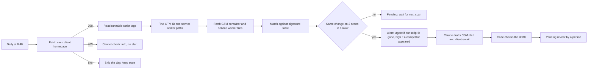

# Site Integration Monitor: early technical churn signals in n8n

A portfolio project using fictional client sites. Once a day it reads the public code of each client's website and checks whether our (fictional) web push script is still installed and whether a competitor's push script has appeared. A confirmed change becomes an alert for the Customer Success Manager, with the exact file and code fragment as evidence, plus an email draft that waits for a person to approve it. It does not contact anyone.

**Built and tested, not deployed.** Everything runs against eight invented shops served by an n8n webhook. It has not been used with real clients.

## Problem

A SaaS product that installs on the client's website with a script can lose a client quietly. The client's team adds a competitor's script, or removes ours during a redesign, and nobody tells us. Usually it shows up only when results drop or the cancellation arrives. By then the conversation is about leaving, not about fixing.

## How it works

1. **Fetch.** One request per client homepage, once a day, with an honest user agent. Public pages only.
2. **Read scripts.** Only `<script>` tags the browser would run count. Text, links, `<code>` blocks, HTML comments and data blocks like `application/ld+json` are ignored.
3. **Look deeper.** If the page loads Google Tag Manager, the scanner fetches the container and reads the tags inside it (GTM stores tag HTML escaped, so it is unescaped first). It also fetches the standard service worker paths of each vendor plus any path the page registers.
4. **Match.** A signature table lists vendor, pattern and where to look. A vendor counts as installed only when its loader runs on the page or through GTM. A service worker file alone is extra evidence, not proof.
5. **Compare.** Today's result is compared with the confirmed state. A change becomes an alert only when two successful scans in a row show the same change. Levels: **urgent** (our script is gone), **high** (a competitor appeared), **info** (the site cannot be checked).
6. **Draft.** Detection is pure rules. Claude only writes words: an internal alert with the evidence, and a client email. The email prompt never sees the evidence, the vendor names or the client name.
7. **Check.** Code checks every draft before a person sees it.

### Signature table

Competitor patterns come from each vendor's public documentation. Where I could not find a pattern in the docs, I left it out rather than guess.

| Vendor | Page script pattern | Service worker | Source |
| --- | --- | --- | --- |
| ExamplePush (ours, fictional) | `cdn.examplepush.example/sdk/` | `/examplepush-sw.js` | invented |
| OneSignal | `cdn.onesignal.com/sdks/web/` | `/OneSignalSDKWorker.js` → `OneSignalSDK.sw.js` | OneSignal service worker docs |
| PushEngage | `clientcdn.pushengage.com/sdks/` | not used (content not in public docs) | PushEngage security notice naming its embed scripts |
| iZooto | `cdn.izooto.com/scripts/` | not used (content not in public docs) | iZooto AMP setup guide |
| Pushwoosh | `cdn.pushwoosh.com/webpush/` | `/pushwoosh-service-worker.js` | Pushwoosh Web Push SDK 3.0 docs |
| Webpushr | `cdn.webpushr.com/` | `/webpushr_sw.js` → `sw-server.min.js` | Webpushr forum (official) |

Full rows with links: `signatures.csv`.

## Test scenarios

Eight fictional shops, each with five simulated days. The pages, GTM containers and service worker files are stored in a data table and served by the `SIM Mock Sites` webhook.

| | Scenario | What it tests | Expected |
| --- | --- | --- | --- |
| A | Stable, our script present | Baseline, no noise | no alert |
| B | Competitor added in page code (day 3) | Basic detection and the 2-scan rule | high on day 4 |
| C | Competitor added only through GTM (day 2) | Looking deeper than the HTML | high on day 3 |
| D | Our script removed (day 3), old service worker file left | A leftover file must not hide the loss | urgent on day 4 |
| E | Our script replaced by a competitor (day 2) | "Ours missing" wins over "competitor" | urgent on day 3 |
| F | Bot protection returns 403 every day | No workaround, no false alarm | cannot check, no alert |
| G | One day of server error 500 (day 3) | Errors do not count as a change | no alert |
| H | Competitor named in a blog post and JSON-LD (day 2) | False-alarm trap | no alert |

## Test results

| Test | Result |
| --- | --- |
| Detection: 40 checkpoints (8 sites × 5 days) | **40 of 40** correct |
| Missed alerts | **0** |
| False alarms | **0** |
| AI drafts checked by code (4 alerts, CSM alert + client email each) | 4 of 4 pass, after two fixes found by reading the drafts |
| Draft checker on 13 hand-written emails (11 bad, 2 good) | **13 of 13** judged correctly |

The detection test passed 40 of 40 in three separate runs (`EVAL-20261109-203059`, `-203712`, `-204030`); the last one is in `test-results.csv`. Draft checks are in `draft-test-results.csv`. Method and details: `test-results.md`. Example drafts: `sample-results.md`.

These are tests on fictional pages, and I wrote the expected answers before the first run. They show the rules behave as designed on these eight scenarios, not that the monitor would catch every real installation.

## What did not pass the first time

- **The test loop stopped after day 1.** Twice. The node that calls the scanner returned nothing, because the scanner's last node was a filter with no matches on day 1, so the loop never continued. The scanner itself was right. I added a final `Run finished` node to the scanner and set the call to always return an item. The third run passed 40 of 40.
- **Code checks passed, my own reading did not.** In the first draft run all 4 drafts passed the code checks, but when I read them, 2 technical-help emails thanked the client "for reaching out" and apologised, as if the client had reported a problem. They had not. I added a prompt rule and two code checks (no thanks-for-contacting or apology; a technical-help email must say "it looks like" or "may have"), plus 2 new hand-written test emails. The new check flags both original emails.
- **Then the subjects.** In the second run the email bodies were careful, but two subjects still said "Notifications stopped showing". I added a subject check, a prompt rule and one more test email. In the third run all 4 drafts passed and I found nothing wrong reading them. Before and after: `sample-results.md`.

## Ethics and limits

- **Public code only.** The scanner reads what any browser downloads: the homepage, the public GTM container and public service worker files. No login, no forms, no private pages.
- **Once a day,** with throttled requests and a user agent that names the tool.
- **No workarounds.** A 403 or bot challenge stops the check for that site: the result is "cannot check" and a person decides what to do. The scanner does not change its user agent, retry around the block or use proxies.
- **Client emails never mention monitoring or competitors.** A person approves every draft. Nothing is sent automatically.
- **Consent-gated scripts are invisible.** Scripts that load only after cookie consent, or are injected by other JavaScript at runtime, do not appear in the raw HTML or GTM container. Next step: a headless browser that loads the page like a visitor (and respects the consent choice).
- **Signatures go stale.** Vendors change CDN paths. The table needs an owner and a regular review.
- **Fictional data.** The thresholds and the 2-scan rule have not been tuned on real churn.
- **Not legal advice.** A real deployment needs a check against the client contract and local law.

## Tools

- n8n, n8n Data Tables, Webhook, HTTP Request, Execute Sub-workflow
- JavaScript in n8n Code nodes (parsing, signatures, state rule, draft checks)
- Anthropic Claude Haiku (drafts only)
- Claude for AI-assisted building, review and testing

## My role

I built this project with AI assistance. I defined the problem, the eight scenarios and the expected answer for every checkpoint before the first run, the 2-scan rule and the alert levels, the rule that client emails never mention monitoring or competitors, and the ethics limits. I read the drafts and decided on the fixes.

## Files

- `Site Integration Monitor.json`: the scanner
- `SIM Mock Sites.json`: the fictional sites (webhook) and the page generator
- `SIM Drafts.json`: AI drafts and code checks
- `SIM Eval.json`: detection test, 40 checkpoints
- `SIM Draft Eval.json`: draft test and checker test
- `signatures.csv`: signature table with sources
- `demo_clients.csv`: 8 fictional clients
- `mock_pages.csv`: 40 stored pages (8 sites × 5 days) with GTM containers and service worker files
- `eval_cases.csv`: expected result for each checkpoint
- `test-results.csv`, `draft-test-results.csv`: test results
- `test-results.md`: test method and results
- `sample-results.md`: example alerts and emails, before and after the fix
- `JAK_TO_DZIALA.md`: plain-language notes in Polish

Workflows are exported without credentials. The n8n trial these were built on ends soon, so the exports and CSV files are the record.

## How to import

1. Create data tables `SIM Mock Pages`, `SIM Clients`, `SIM Signatures`, `SIM State`, `SIM Scan Log`, `SIM Alerts`, `SIM Eval Cases`, `SIM Test Results` (columns as in the CSV files and the workflow nodes) and import the CSV files.
2. Import the five workflow JSON files and select your own data tables in every data table node.
3. Publish `SIM Mock Sites`, run its `Rebuild mock pages` trigger, and change the webhook host in `demo_clients.csv` to your instance.
4. Select an Anthropic credential in `SIM Drafts` → `Write draft`.
5. In `SIM Eval` and `SIM Draft Eval`, select the scanner and the drafts workflow in the sub-workflow nodes. Run `SIM Eval`, then `SIM Draft Eval`.

## Next improvements

- Headless browser for consent-gated and runtime-injected scripts.
- Combine the site signal with our own delivery data (subscriptions and deliveries per client).
- An error workflow that alerts a person when a run fails or a signature stops matching anywhere.
- A review form like in my Churn Risk Alert project.
